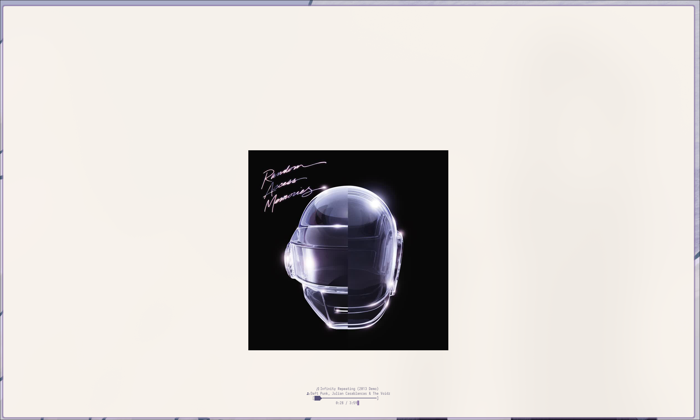

# CCover
Display the cover of the song you're listening on your terminal!
 
> [!NOTE]
> It Only Supports Kitty and CMUS at the moment

> [!NOTE]
> Not too stable at the moment, expect bugs!

## lyrics.sh 
This is a Script made for displaying lyrics of the song you're listeing
> [!NOTE]
> The lyrics.sh script **only works if theres a .lrc file**

# How to install
## Script
```
git clone https://git.disroot.org/SrTortugardo/ccover.git
cd ccover
doas sh install.sh
```
> [!NOTE]
> If you use *sudo* instead of *doas*, change it

## Manual
```
git clone https://github.com/polmacarnii/ccover.git
cd ccover
```
### ccover
Now, there is an script called "build.sh", for compile do :
```
sh build.sh
```
It will produce a binary called "ccover". 
### lyrics.sh 
it does not need to be compiled because its an script, the script is at ```src/lyrics.sh```

## install
Now its your turn to move the binarys to wherever you want to

# Dependencies
## Build Dependencies
- LIBC (With Support for POSIX)
- A Compiler
- GNU Make
## Runtime Dependencies
- ffmpeg
- CMUS running
- A Kitty Terminal executing this program
- A Nerd Font installed

## Runtime dependencies for lyrics.
- sh 
- system utils
- gawk

# Compatibility
- GNU/Linux (x86_64 & aarch64) -> Working
- MacOS X (aarch64) -> Working
However, if you system has all the Dependencies the most probable thing is that it would work
